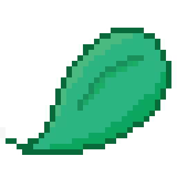

# Mint

**Mint** is a client-side Bedwars resource tracker. It tracks how many resources you have in your inventory and in your Ender Chest. The mod is focused around hypixel, but should work fine for most other servers aswell.

I made thie because the alternatives have _meh_ HUDs or don't support hypixel's new punch to deposit feature.

If you run into issues or have suggestions, feel free to open an issue on [GitHub](https://github.com/bewf/Mint/issues).

## Example HUD

   
  <em>Vertical layout</em>

   
  <em>Horizontal layout</em>

<!-- i will add waypoint image later:

   
  <em>Chest waypoints</em>

-->

## Features

- Tracks Iron, Gold, Diamonds, and Emeralds
- Shows inventory, Ender Chest, and total amounts in different colours.
- Supports punch-to-deposit and manual deposits
- Waypoints above chest/enderchest showing resources
- Config through OneConfig
- Fully client-side and safe for Hypixel
- Should automatically enable on most other bedwars servers.
  - If it doesn't, turn on "Always Show HUD" in the Debug menu.
- Team chest sync through party chat with others who have the mod. Hypixel works by default
  - You can add other servers under Team Chest in the settings.

> **Use party sync at your own risk.** Party sync works by sending a message through party chat. I don't expect it to cause problems, but I can't promise every/any public server will allow it. You can turn it off in the settings.

## OneConfig Integration

   
  <em>Mint is fully configurable through OneConfig.</em>

--- 

##### Code licensed under [ARR](https://github.com/bewf/mint/blob/main/LICENSE.md). Unmodified redistribution **in free modpacks** is permitted with credit. See the [full license](https://github.com/bewf/mint/blob/main/LICENSE.md) on GitHub for details.
