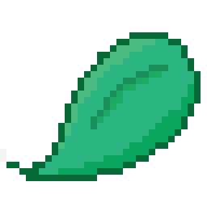
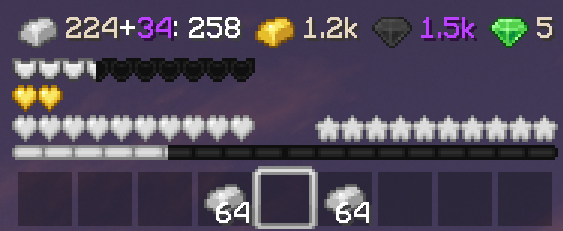
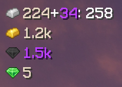
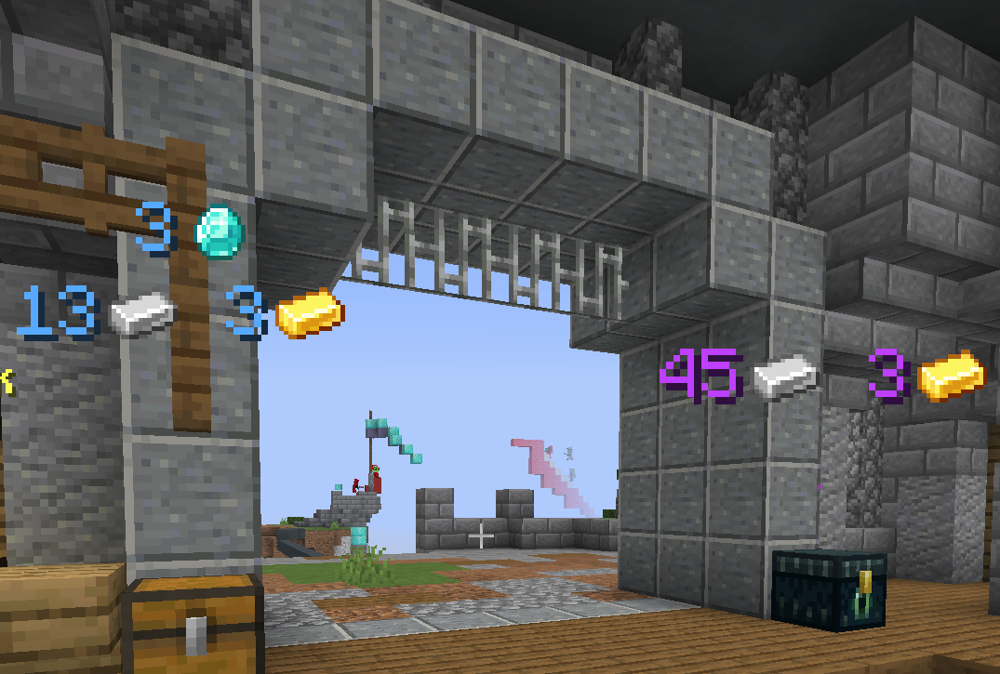

# Mint

  
  
  

**Mint** is a client-side Bedwars resource tracker. It tracks how many resources you have in your inventory, team chest, and ender chest. I originally made this for myself because I didn't like the alternatives. The mod should works fine on all servers and support **Hypixel's Punch to Deposit** feature.

If you run into issues or have suggestions, feel free to open an issue on [GitHub](https://github.com/bewf/Mint/issues).

## Example Images

  
  &nbsp;&nbsp;
  
   
  <em>Horizontal and vertical layouts</em>

   
  <em>Chest waypoints</em>

## Features

- Tracks Iron, Gold, Diamonds, and Emeralds
- Shows inventory, Ender Chest, and total amounts in different colours.
- Supports punch-to-deposit and manual deposits
- Waypoints above chest/enderchest showing resources
- Config through OneConfig
- Fully client-side and safe for Hypixel
- Should automatically enable on most other bedwars servers.
    - If it doesn't, turn on "Always Show HUD" in the Debug menu.
- Team chest sync through party chat with others who have the mod. Hypixel works by default
    - You can add other servers under Team Chest in the settings.

> **Use party sync at your own risk.** Party sync works by sending a message through party chat. I don't expect it to cause problems, but I can't promise every/any public server will allow it. You can turn it off in the settings.

## OneConfig Integration

   
  <em>Mint is fully configurable through OneConfig.</em>

--- 

##### Code licensed under [ARR](https://github.com/bewf/mint/blob/main/LICENSE.md). Unmodified redistribution **in free modpacks** is permitted with credit. See the [full license](https://github.com/bewf/mint/blob/main/LICENSE.md) on GitHub for details.